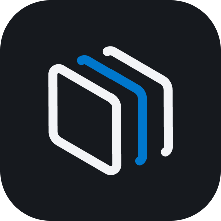
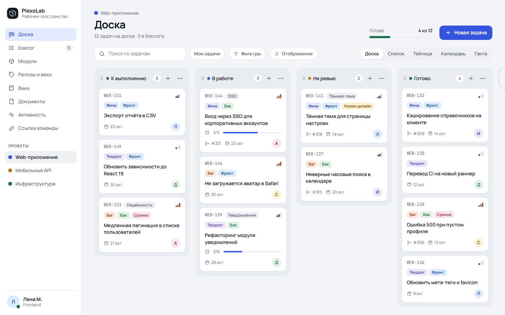
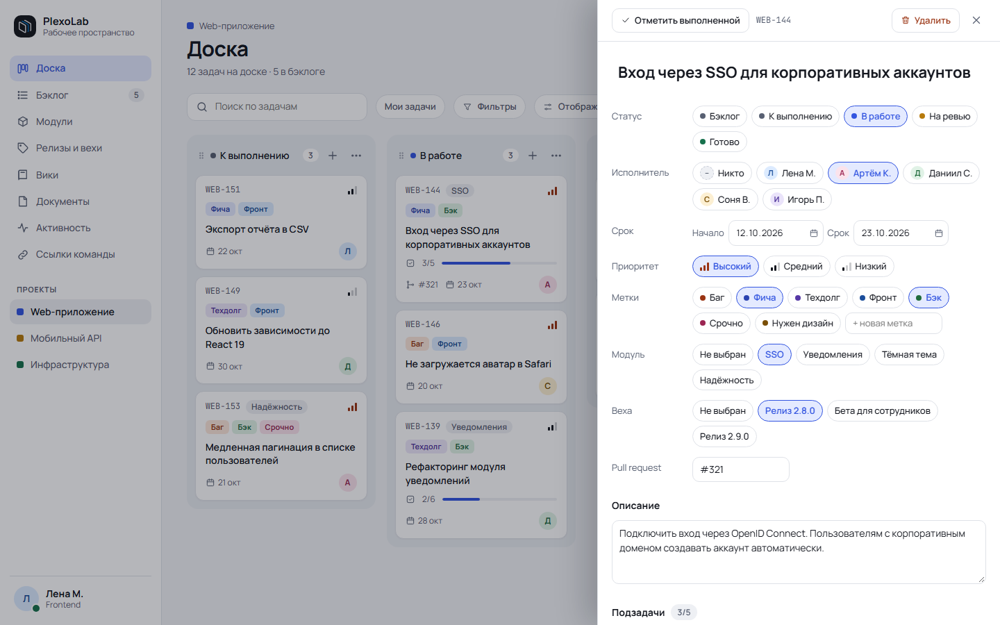
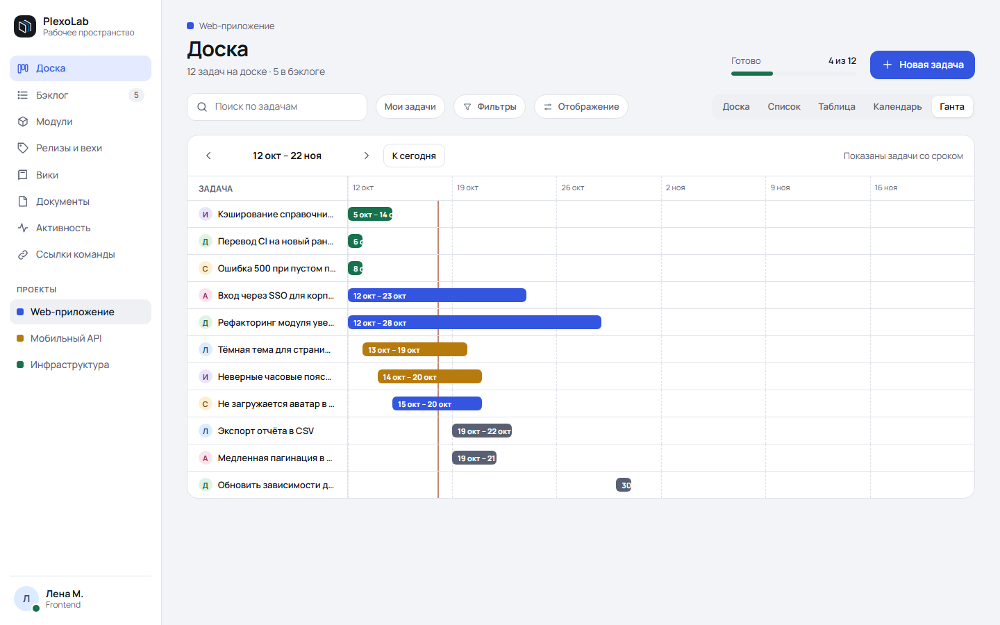
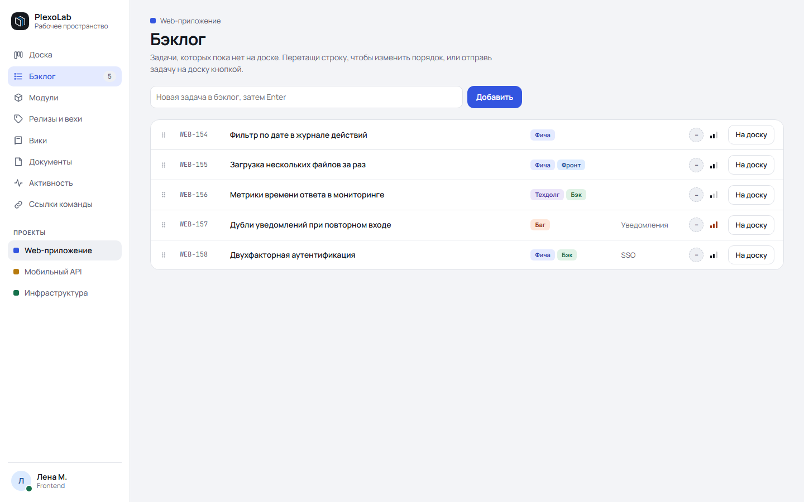
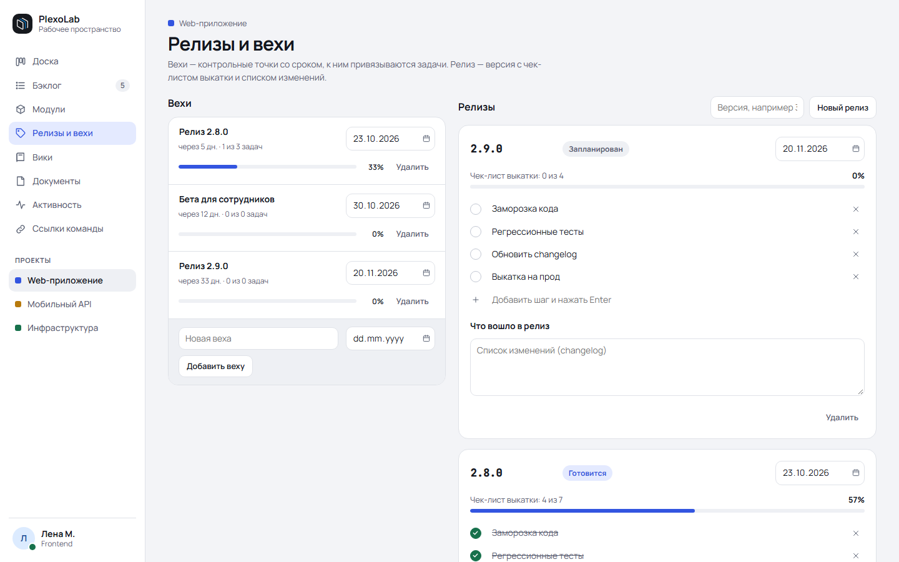
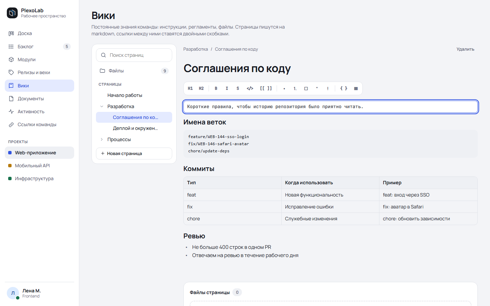
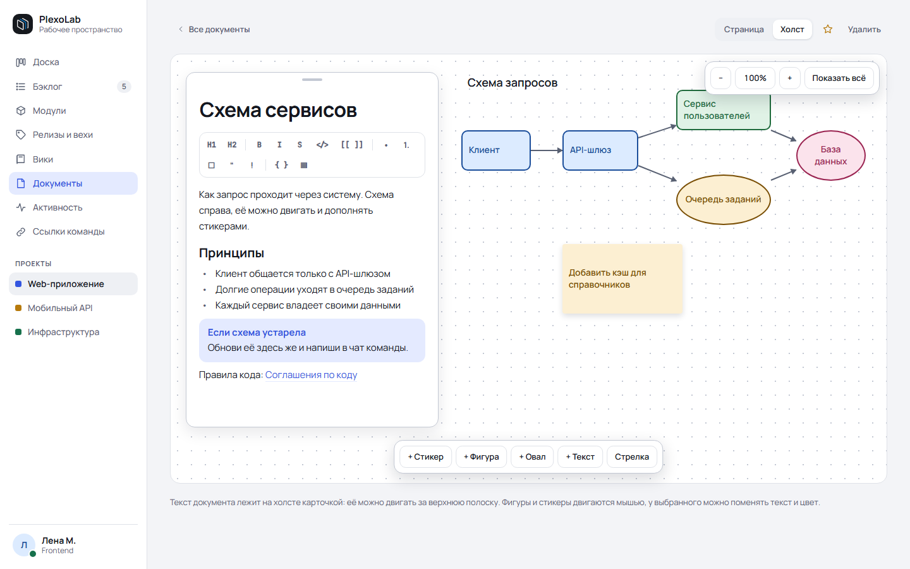

<p align="center">
  
</p>

<h1 align="center">PlexoLab</h1>

<p align="center">
  Рабочее пространство для небольшой команды разработки:<br>
  доска, бэклог, релизы, вики и документы с холстом в одном десктоп-приложении.
</p>

<p align="center">
  
  
  
  
  
</p>

<p align="center">
  <picture>
    <source media="(prefers-color-scheme: dark)" srcset="docs/screenshots/board-dark.png">
    
  </picture>
</p>

## Что умеет

- **Доска.** Канбан с перетаскиванием карточек и колонок. Пять видов: «Доска», «Список», «Таблица», «Календарь» и «Ганта». Фильтры, поиск, настройка того, что видно на карточке.
- **Бэклог, модули, релизы и вехи.** Задачи делятся на модули, модули привязаны к вехам, релизы идут по шагам.
- **Вики.** Дерево страниц и библиотека файлов. Редактор в стиле Obsidian: блок, по которому кликнули, превращается в исходный markdown, остальные остаются отрисованными. Ссылки между страницами `[[Страница]]`.
- **Документы.** Каждый документ можно вести как страницу или как холст: стикеры, фигуры, стрелки, свободное поле с масштабом.
- **Команды и проекты.** Несколько команд, у каждого человека своя личная. В командах проекты с ключами задач (`WEB-144`), участники, роли и приглашения.
- **Всё вживую.** Правки коллег появляются сразу, видно, кто в каком блоке страницы. Если двое правят один текст, правки сливаются, как в git.
- **Уведомления и поиск.** `@упоминания`, окошки Windows, поиск по названиям на `Ctrl+K`.
- **Без паники при обрыве связи.** Приложение переходит в режим «только просмотр», а несохранённый текст не пропадает.
- **Приложение для Windows.** Светлая и тёмная темы, значок в трее, автозапуск, один запуск на компьютер.
- **Регистрация по почте.** Код из письма при регистрации и сбросе пароля (почта через Resend, по желанию).

<p align="center">
  
</p>

## Экраны

Каждый экран есть в светлой и тёмной теме. На GitHub показывается та, что стоит у вас.

<table>
  <tr>
    <td width="50%" align="center">
      <picture>
        <source media="(prefers-color-scheme: dark)" srcset="docs/screenshots/task-dark.png">
        
      </picture>
      <br><sub><b>Задача:</b> исполнитель, срок, метки, модуль, веха, PR, подзадачи</sub>
    </td>
    <td width="50%" align="center">
      <picture>
        <source media="(prefers-color-scheme: dark)" srcset="docs/screenshots/gantt-dark.png">
        
      </picture>
      <br><sub><b>Диаграмма Ганта</b> по тем же задачам</sub>
    </td>
  </tr>
  <tr>
    <td width="50%" align="center">
      <picture>
        <source media="(prefers-color-scheme: dark)" srcset="docs/screenshots/backlog-dark.png">
        
      </picture>
      <br><sub><b>Бэклог</b> с переносом строк</sub>
    </td>
    <td width="50%" align="center">
      <picture>
        <source media="(prefers-color-scheme: dark)" srcset="docs/screenshots/releases-dark.png">
        
      </picture>
      <br><sub><b>Релизы и вехи</b></sub>
    </td>
  </tr>
  <tr>
    <td width="50%" align="center">
      <picture>
        <source media="(prefers-color-scheme: dark)" srcset="docs/screenshots/wiki-dark.png">
        
      </picture>
      <br><sub><b>Вики:</b> активный блок виден как markdown</sub>
    </td>
    <td width="50%" align="center">
      <picture>
        <source media="(prefers-color-scheme: dark)" srcset="docs/screenshots/canvas-dark.png">
        
      </picture>
      <br><sub><b>Документ:</b> страница и холст рядом</sub>
    </td>
  </tr>
</table>

## Как это устроено

```
Windows-клиент (Tauri 2 + React)  --HTTPS / WSS-->  Rust-сервер (axum)  -->  PostgreSQL
                                                          |
                                                          +--> диск: загруженные файлы
```

Клиент ставится одним `.exe`, данные лежат на сервере. При первом запуске приложение спрашивает адрес сервера и логин, дальше открывается сразу.

| | |
|---|---|
| **Клиент** | Tauri 2, React, TypeScript, Vite; Zustand и TanStack Query; `dnd-kit`; обычный CSS без UI-библиотек |
| **Сервер** | Rust, axum, tokio, sqlx; PostgreSQL; argon2 и JWT; OpenAPI (utoipa); живые обновления по WebSocket |
| **Проверки** | `sqlx::test` на настоящем Postgres, Playwright: сравнение с эталонными скриншотами и сквозные сценарии |

Интерфейс повторяет макет из [`design/`](design/) один в один, а каждый экран сравнивается с эталонными скриншотами автоматически. Сервер рассчитан на скромное железо: вместе с PostgreSQL он должен умещаться примерно в 300 МБ памяти на машине с одним ядром и 1 ГБ.

## Быстрый старт

Понадобятся Rust (MSVC-тулчейн и Visual Studio Build Tools с компонентом C++), Node.js 24, PostgreSQL 18 и WebView2 (в Windows 11 он уже есть).

```powershell
# 1. База и настройки
createdb -U postgres plexolab
copy .env.example .env             # поправьте DATABASE_URL и JWT_SECRET

# 2. Сервер (миграции применятся сами) и демо-данные
npm run dev-server
npm run seed                       # в другом окне терминала; вход lena@example.com, пароль dev

# 3. Клиент
npm --prefix app install
npm run dev-app                    # окно Tauri; первая сборка занимает несколько минут
```

Без Tauri клиент запускается и в обычном браузере: `npm run dev-app-web`, адрес `http://localhost:1420`. Адрес сервера при входе: `http://127.0.0.1:8080`. Проверка сервера: `GET /healthz` отвечает `ok`.

Все команды запускаются из корня репозитория:

| Команда | Что делает |
|---|---|
| `npm run dev-server` | запускает сервер (применяет миграции, слушает `127.0.0.1:8080`), настройки из `.env` |
| `npm run seed` | заполняет пустую базу демо-данными. Параметры: `npm run seed -- --reset` (сначала стереть всё), `--today 2026-10-18`, `--password dev` |
| `npm run dev-app` | запускает клиент в окне Tauri |
| `npm run dev-app-web` | клиент в обычном браузере на `http://localhost:1420`, без Tauri. Витрина компонентов: `/showcase` (обе темы) или `/showcase?theme=dark` |
| `npm run test` | тесты сервера (нужен Postgres), линтер, проверка типов и сборка клиента |
| `npm run test-visual` | Playwright: сравнение с эталоном и снимки витрины (нужен браузер Chromium, установка: [DEVELOPMENT.md](docs/DEVELOPMENT.md#визуальные-тесты)) |
| `npm run update-visual` | пересоздать снимки витрины после намеренных изменений вида |
| `npm run readme-media` | переснять картинки для этого README в `docs/screenshots/` |
| `npm run build-server` | релизная сборка сервера |
| `npm run build-app` | установщик NSIS локально; обычно его собирает GitHub Actions по тегу ([как выпустить версию](docs/DEVELOPMENT.md#проверки-и-релиз-в-github-actions)) |

## Документация

Полное оглавление: [`docs/README.md`](docs/README.md). С чего начать:

| Документ | О чём |
|---|---|
| [`docs/ARCHITECTURE.md`](docs/ARCHITECTURE.md) | схема системы, структура репозитория, развёртывание на сервере в 1 ГБ |
| [`docs/SPEC.md`](docs/SPEC.md) | как ведёт себя каждый экран |
| [`docs/DATA-MODEL.md`](docs/DATA-MODEL.md) | таблицы PostgreSQL и ручки API |
| [`docs/DEVELOPMENT.md`](docs/DEVELOPMENT.md) | настройки сервера, пользователи, устройство клиента по экранам, тесты, сборка и релиз |
| [`docs/TEAMS.md`](docs/TEAMS.md) и [`docs/PROJECTS.md`](docs/PROJECTS.md) | команды, проекты, участники, права, ключи задач |
| [`docs/EDITOR-AND-CANVAS.md`](docs/EDITOR-AND-CANVAS.md) | markdown-редактор и холст |
| [`docs/OFFLINE-NOTIFY-SEARCH.md`](docs/OFFLINE-NOTIFY-SEARCH.md) | работа без связи, уведомления, поиск |
| [`docs/REGISTRATION.md`](docs/REGISTRATION.md) | регистрация и сброс пароля по почте |

## Состав репозитория

```
app/           клиент: Tauri 2, React, TypeScript
server/        сервер: Rust (axum), миграции sqlx
design/        эталон интерфейса: макет и скриншоты, только чтение
docs/          документация
tests/visual/  Playwright: сравнение с эталоном, сквозные сценарии, картинки для README
deploy/        заготовка под развёртывание на сервере (этап 10)
```

## Статус

Проект в разработке. Готовы все экраны макета с настоящим сервером, проекты и команды, регистрация по почте, обновления в реальном времени, работа без связи, уведомления и поиск. Впереди развёртывание сервера (скрипты, резервные копии, нагрузочная проверка). Установщик пока не подписан сертификатом: при первом запуске Windows покажет «Неизвестный издатель».

## Лицензия

[GNU AGPL-3.0](LICENSE).
